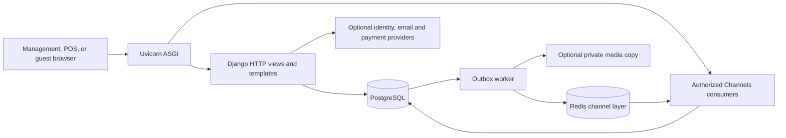

# Veyra

**Everything in sync.**

Veyra is a multi-tenant point-of-sale and business operations platform for cafés, restaurants, bakeries, and other businesses that take orders and manage stock. It connects the guest menu, register, preparation queue, inventory, purchasing, and sales reporting. Boskaf Coffee and Roastery was the original pilot context. Each Veyra business has its own configuration, staff access, catalog, and merchant accounts.

[Capabilities](#what-you-can-do) · [Architecture](#stack-and-architecture) · [Windows setup](#run-locally-on-windows) · [Checks](#verify-a-change) · [Documentation](#documentation)

## What you can do

| Area | Current capability |
| --- | --- |
| Accounts and businesses | Verify email, recover a password, use authenticator MFA, own or join several businesses, manage locations, and grant collaborators specific permissions. Google sign-in and explicit account linking await live consent verification. |
| Catalog and campaigns | Manage categories, products, photos, reusable modifiers, availability, scheduled prices, banners, and voucher rules. |
| Guest ordering and branding | Take dine-in orders from signed table QR links and takeaway orders from location links. Guests can edit a cart, choose an available payment method, and privately track status over WebSockets. Owners can preview, publish, unpublish, and restore designs through the Ordering Page Builder. |
| POS and operations | Create dine-in and takeaway orders, record cash or terminal-card acceptance, issue receipt previews, and advance kitchen and bar orders. Pair restricted devices and manage print jobs. Actual printing needs a compatible client and printer. |
| Inventory and purchasing | Track stock and recipe movements by location, reconcile counts, manage suppliers and purchase orders, receive deliveries in stages, and record supplier returns. |
| Payments and billing | Record cash or terminal-card refunds and use tenant Midtrans or BCA SNAP QRIS adapters in supported guest and device workflows. Platform subscriptions use a separate Midtrans merchant for customer-initiated payments. Live merchant onboarding, settlement, and refund acceptance remain open. |
| Reports and updates | Filter actual sales, product totals, payment and fulfillment breakdowns, confirmed refunds, and voucher performance. PostgreSQL and Redis synchronize supported workflows. See the feature inventory for reporting and synchronization gaps. |

[Feature status and verification](docs/FEATURE-STATUS.md)

## Stack and architecture

- Python 3.12 or newer, Django ``>=5.2,<6.2``, psycopg 3, and PostgreSQL. The release image uses Python 3.12. Local Compose uses PostgreSQL 17 and Redis 7.
- Uvicorn serves Django HTTP and Django Channels WebSockets from one ASGI application. Redis carries Channels messages and backs the production cache. A compatible authenticated Valkey service is a hosting option.
- Django templates, CSS, and browser JavaScript render the application. GSAP and ScrollTrigger 3.13.0 enhance the public landing page. WhiteNoise serves collected static files outside debug.
- Pillow normalizes uploads. PostgreSQL retains the image bytes. A private Supabase Storage copy is optional. Email can use local console output, SMTP, or Resend. Google and payment providers need separate configuration.
- Django and Channels cover automated regressions. Playwright with Chrome, Firefox, and WebKit was used for recorded local browser verification.



Management resolves the business, active membership or owner, permission, and location scope where implemented. Paired stations use separate capabilities. PostgreSQL is authoritative for price, order status, stock, billing, and pending events. [Architecture](docs/ARCHITECTURE.md) · [Data model](docs/DATABASE.md)

## Run locally on Windows

Open the checkout in PowerShell with Git, Docker Desktop or Docker Engine with Compose, and Python installed. This example uses Python 3.14. Select another installed Python 3.12 or newer if needed.

```powershell
py -3.14 -m venv .venv
.\.venv\Scripts\python.exe -m pip install -e ".[dev]"
if (-not (Test-Path .env)) { Copy-Item .env.example .env }
docker compose up -d postgres redis
docker compose ps
```

Wait for both services to report healthy, then apply the migrations and start ASGI.

```powershell
.\.venv\Scripts\python.exe manage.py migrate
.\.venv\Scripts\python.exe -m uvicorn config.asgi:application --reload --no-access-log
```

Open [the local app](http://127.0.0.1:8000/). Run the outbox and account mail workers in separate PowerShell windows at the same checkout. Register and open the verification link printed by the account mail worker when using the default development mail backend.

```powershell
.\.venv\Scripts\python.exe manage.py process_outbox
# Separate terminal
.\.venv\Scripts\python.exe manage.py process_account_mail
```

Debug ASGI serves static files directly. The production image collects static files during the build. [POSIX setup and troubleshooting](docs/DEVELOPMENT.md) · [Environment variables](docs/ENVIRONMENT.md)

## Verify a change

```powershell
.\.venv\Scripts\python.exe manage.py check
.\.venv\Scripts\python.exe manage.py makemigrations --check --dry-run
.\.venv\Scripts\python.exe manage.py test --noinput
.\.venv\Scripts\python.exe manage.py check_realtime
```

Django creates an isolated test database. Use local PostgreSQL and Redis for integration coverage. [Tests and browser workflows](docs/TESTING.md)

## Documentation

| Need | Start here |
| --- | --- |
| Requirements and release status | [Product requirements](docs/PRD.md), [feature status](docs/FEATURE-STATUS.md), [release evidence history](docs/RELEASE-HISTORY.md) |
| Code and interfaces | [Architecture](docs/ARCHITECTURE.md), [database](docs/DATABASE.md), [routes](docs/FEATURES-AND-ROUTES.md), [station API](docs/STATIONS-AND-DEVICE-API.md), [real-time delivery](docs/REALTIME.md) |
| Security and money | [Security](docs/SECURITY.md), [permissions](docs/permissions.md), [payments and billing](docs/PAYMENTS.md) |
| Development and operations | [Development](docs/DEVELOPMENT.md), [configuration](docs/ENVIRONMENT.md), [testing](docs/TESTING.md), [deployment](docs/DEPLOYMENT.md), [operations](docs/OPERATIONS.md), [integrations](docs/INTEGRATIONS.md) |
| Design and storefront | [UI handoff](docs/UI-DESIGN-HANDOFF.md), [Ordering Page Builder](docs/ORDERING-PAGE-BUILDER.md), [landing film](docs/landing-cinematic-workflow.md) |
