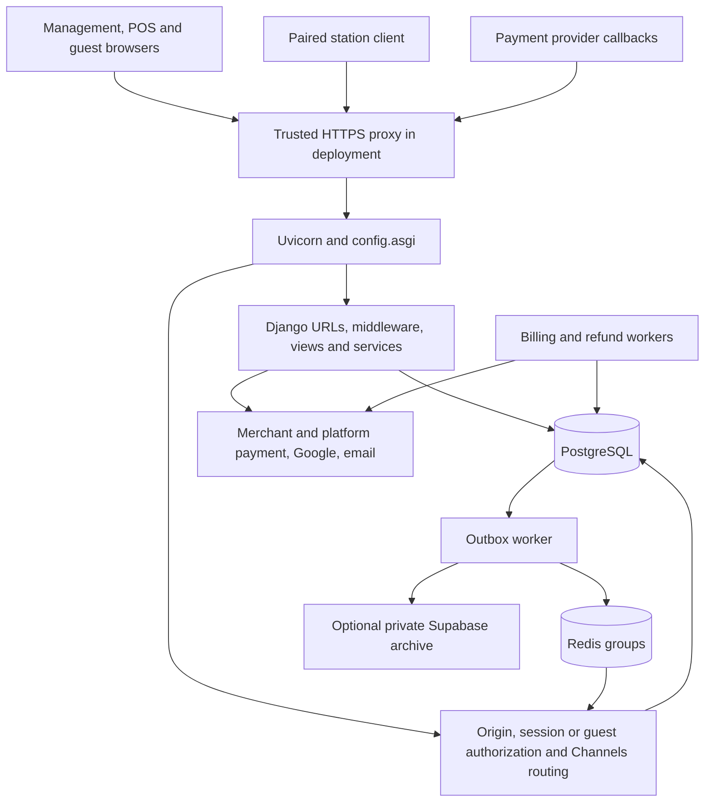

# Architecture

Veyra is a Django modular monolith. [config](../config/) contains runtime configuration and root routing. One application, [core](../core/), uses a shared PostgreSQL schema. Django serves browser pages and the restricted station API. Separate local worker processes use the same code and database.

## Request and event flow

Django's session and CSRF middleware process browser actions. ASGI wraps Channels routes with origin validation, Django authentication and MFA proof checks. In debug, an ASGI static-file handler serves assets. In production, WhiteNoise serves collected static files. Uploaded assets use scoped application views.

## Boundaries in core

| Area | Main code |
| --- | --- |
| Management, checkout and order state | [views](../core/views.py), [services](../core/services.py), [customer views](../core/customer_views.py), and [receipts](../core/receipt_views.py) |
| Catalog and merchandising | [catalog](../core/catalog_views.py), [modifiers](../core/modifier_views.py), [vouchers](../core/voucher_views.py), and [media](../core/media_views.py) |
| Inventory and purchasing | [purchasing views](../core/purchasing_views.py), [stock reconciliation](../core/stock_reconciliation.py), and shared transactional services |
| Ordering Page Builder | [editor views](../core/ordering_views.py), [ordering page service](../core/ordering_page.py), and the guest templates |
| Identity, authorization and observability | [identity](../core/identity.py), [identity views](../core/identity_views.py), [stream permissions](../core/permissions.py), [security headers](../core/middleware.py), and [observability](../core/observability.py) |
| Devices, tenant payments and platform billing | [device API](../core/device_views.py), [tenant adapters](../core/payments/), [refunds](../core/refunds.py), [billing](../core/billing.py), and [platform payment gateway](../core/billing_gateway.py) |

Server-rendered [templates](../templates/) provide the HTML workflows. Shared and domain-specific [CSS and JavaScript](../core/static/core/) enhance navigation, validation, filtering, private previews and live updates. The app has no separate frontend build. The landing page loads GSAP and ScrollTrigger from jsDelivr and keeps a reduced-motion and no-motion fallback.

## Tenants and locations

The route's business slug selects a candidate tenant. Management views resolve the canonical owner or active membership, require permissions, and scope objects and mutable references to that tenant. Owners have implicit business access. Collaborators receive named permissions, with optional location restrictions for inventory and purchasing. Settings, merchant connections and billing have explicit owner checks where required. Entitlement checks are separate from permissions.

A business can own several locations. Locations scope table links, takeaway, inventory balances, purchase orders, station queues and eligible pricing. A report's location filter narrows results within a business and is not a grant. Department, Workspace and WorkspaceAssignment preserve relationships and legacy configuration. Current device access is implemented through Station, optional station location, one-use pairing code, and a hashed bearer token with capabilities. WorkspaceAssignment does not authorize the active application. [Access model](permissions.md) · [Historical ownership decision](architecture-reconciliation.md)

## Orders, payments and storage

Guest entry links resolve an active signed table or pickup location. Session-scoped carts use the same catalog and pricing rules as POS and station order creation. Pricing, selections, totals and operational transitions are checked server-side. Independent order-tracking access uses a signed per-order cookie. The storefront reads the published ordering design. An authenticated private preview uses the same renderer without checkouts.

PostgreSQL stores authoritative orders, price and modifier snapshots, tender and refund history, stock and purchasing, subscription and invoice history, media bytes and outbox events. Related changes and events are committed together. Redis transports event hints and snapshots and supplies the shared production cache. Server checks and client refresh recover authoritative state after reconnect. Redis group delivery is transient. [Real-time behavior](REALTIME.md)

Business payment adapters and platform subscriptions use different credentials and callbacks. Provider notifications and status checks control supported QRIS transitions. Cash and terminal card are cashier-recorded. Billing and refund workers process due records independently of the outbox. [Payments](PAYMENTS.md)

Pillow normalizes uploads. Views enforce business, preview, or live guest eligibility before serving bytes from PostgreSQL. If enabled, the outbox copies normalized bytes to private Supabase Storage for archival redundancy. Public guests continue to use application routes. [Ordering Page Builder](ORDERING-PAGE-BUILDER.md) · [Deployment](DEPLOYMENT.md)
