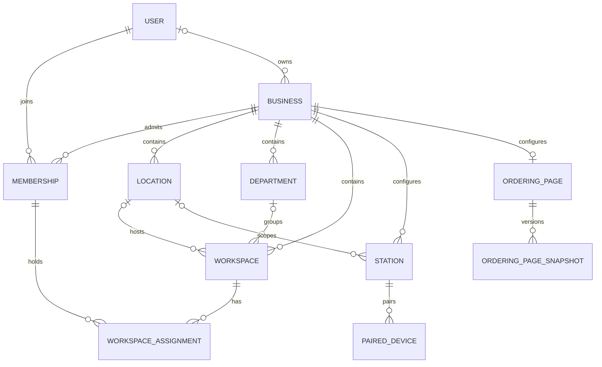
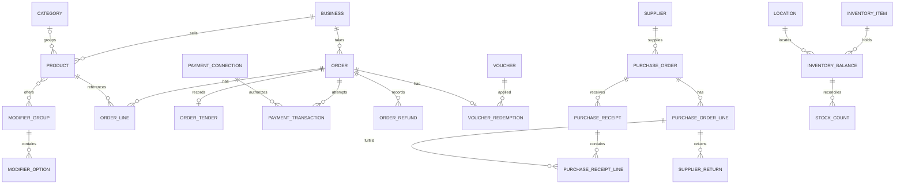

# Data model and integrity

[core/models.py](../core/models.py) defines the application schema. PostgreSQL is authoritative. Redis carries transient events and cache data. The relationships below were checked against Django model metadata. Nullable references and secondary foreign keys are described in the tables.

## Tenancy, workspace and storefront

| Entities | Relationships and constraints |
| --- | --- |
| User, GoogleIdentity, Authenticator | Email is the primary account identifier. Google binds a unique provider subject. The authenticator stores encrypted setup data, replay state and recovery digests. |
| Business, Membership, Invitation | Business has a nullable canonical owner to preserve legacy rows after migration. Membership is unique per user and business. Its explicit permission list and inventory-location grant are independent of Django admin groups. Invitations belong to a business and record the inviting user. |
| Location and DiningTable | A location belongs to a business. A table has a business and location, a unique name within that business and location, and independently revocable ordering-link state. |
| Department, Workspace, WorkspaceAssignment | All derive their tenant from the business or linked membership and workspace. Assignment pairs are unique. These schema relationships are historical configuration, not active grants. |
| Station, Printer, StationPairingCode, PairedDevice | A station has a business and optional location and printer. Pairing and device credentials link to the station. Capabilities and active state are enforced by the API. |
| OrderingPage and OrderingPageSnapshot | Business has at most one ordering page. A page has at most one unnumbered draft and one history snapshot per publication number. Publish locks and updates the live page and history together. |

## Commerce and inventory

| Entities | Relationships and constraints |
| --- | --- |
| Category, Product, ProductImage | Tenant-scoped catalog. Category and station references on Product are optional. ProductImage stores normalized bytes linked to its product. |
| ModifierGroup, ModifierOption, Promotion, Voucher | Groups link to products and locations, and each option belongs to a group. Promotions and vouchers have optional product/category/location targets. Voucher codes are normalized and unique per business. Usage is committed with order creation under locks. |
| GuestCart, Customer and Order | A cart has exactly one table or pickup location scope, is unique per session and scope, and may link to its checked-out order. Customer belongs to a business. An order can reference a location, table, customer, creating user or paired device. |
| OrderLine and OrderLinePromotion | A line references a product and freezes name, category, price, quantities, modifier choices and discount data at checkout. Promotion details are saved separately against the line. Reports and receipts can use captured values after edits to the catalog. |
| PaymentConnection, PaymentTransaction, OrderTender and OrderRefund | Tenant provider connection is unique by business and provider. Payment attempts link to an order and its connection. Tender records staff-confirmed money. Refund records bind to exactly one eligible capture source and keep positive amounts and independent status. Order and payment idempotency are constrained. Refund requests reserve the refundable amount and never rewrite the original capture. |
| Supplier, PurchaseOrder, PurchaseOrderLine, PurchaseReceipt, PurchaseReceiptLine | Business owns supplier and order. Purchase orders reference location, supplier and creator. A receipt references the order and actor. A receipt line links to the original purchase line. Constraints guard duplicate references, receipt replays and invalid amounts. |
| InventoryItem, InventoryBalance, RecipeLine, StockMovement | Balance is unique per item and location and cannot go negative. Recipes reference product and ingredient. Stock movements record tenant, item, location and optional cause, including order and receipt line. Transactional locks protect state changes and the append-only ledger explains deltas. |
| StockCount and SupplierReturn | A count links to a balance and optionally a ledger movement when the quantity changes. A return links to the received purchase line and its reversing stock movement. Returns cannot exceed the received balance or consume unavailable stock. |

## Billing and operational data

BusinessSubscription has one business, current plan, and optional pending plan. BillingInvoice retains subscription and plan references and the agreed price and period. BillingAttempt records provider attempts under an invoice. Constraints prevent multiple open invoices or pending attempts in the protected scope. SubscriptionEvent retains append-only plan/access changes with an optional actor. Tenant payment tables are separate from these billing tables.

AuditEvent preserves important actions. PaymentWebhookEvent records replay and processing evidence. PrintJob holds a durable job linked to an order and optional printer or station. OutboxEvent holds pending delivery work. Application-level append-only protections do not replace database-role restrictions or backups.

Use [migration files](../core/migrations/) for exact history. The latest core file is [0037_ordering_page_builder](../core/migrations/0037_ordering_page_builder.py), which adds drafts and publication history while preserving the previous live design fields. [Development](DEVELOPMENT.md#routine-checks) · [Backup and restore](DEPLOYMENT.md#backup-and-restore)
