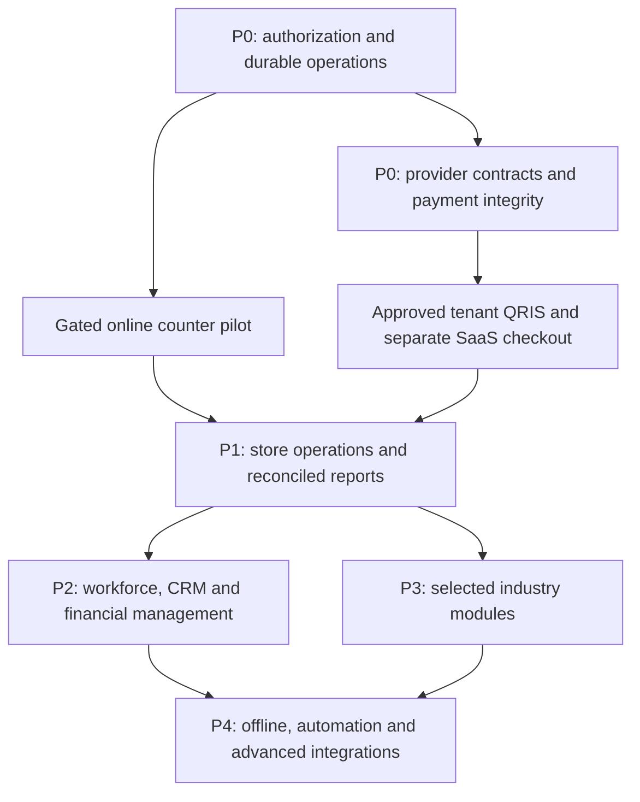

# Veyra product roadmap

Prepared 2026-11-25 from the working tree on `update` at `698ea19`. The 2026-11-26 Priority 0 pass completed the locally verified work indicated below. The sequence still governs external acceptance and expansion. The feature register records current status and dependencies by stable feature ID. [Evidence-based audit](PRODUCT-FEATURE-AUDIT.md) · [Implementation register](FEATURE-IMPLEMENTATION-REGISTER.md)

## Vision

Veyra should provide an online operating core for restaurants, cafés, bakeries, retail stores and other businesses that sell products, manage stock and coordinate staff. A business can adopt sales and inventory first, then enable the modules its operations need. Keep one authoritative sale and inventory record with scoped access, readable history and safe recovery.

### Common core and optional modules

| Scope | Included capabilities | Activation boundary |
| --- | --- | --- |
| Common platform | Tenant identity, canonical ownership, locations, granular grants, audit, privacy, operational health, subscription access, accounting conventions | Required infrastructure for every tenant. Feature and usage entitlements are separate from user authorization. |
| Common commerce | Catalog, online POS, server-side quote and sale snapshots, paid receipts, cash and terminal-card recording, original-tender refunds and sales reports | Base workflow. Tenant QRIS is separately gated by accepted merchant readiness. |
| Stock and procurement | Location balances, stock ledger, counts, purchasing, receiving, returns, transfers, valuation and cost reporting | Enable operational stock management independently. Valuation and COGS depend on formally approved costing. |
| Restaurant service | Signed table entry, table/floor and open-table sessions, bill movement and kitchen displays | Opt in. Retail checkout and inventory must run without tables or preparation. |
| Café/bakery production | Coffee or bakery station presets, recipes, preparation routing, yields, batches, waste and recipe costing | Opt in. Reuse Custom stations and optional BOM now, with production-specific extensions after pilot evidence. |
| Retail | Variant SKUs, barcode/scanner, lot/expiry/serial workflows, stock transfers and optional drawer/terminal integration | Opt in. Avoid imposing barcodes or batch workflows on restaurant service. |
| Storefront and pickup | Ordering Page Builder, existing signed links, cart and tracking, pickup and optional notifications | Opt in to public selling. Verify each published channel and payment method independently. |
| Delivery, loyalty and outreach | Fulfillment dispatch, courier connectors, consented communications, loyalty, gifts and credit | Opt in after privacy, refunds, reversals and liability handling are ready. |

The register uses priority **P0** for critical security, data and payment integrity and hosted readiness. **P1** covers dependable core operations. **P2** covers advanced management. **P3** covers optional industry modules. **P4** covers later offline, analytics, automation and integration work. An optional module may contain a P0 acceptance condition, such as verified merchant credentials. That gate applies when the module is enabled.

## Delivery sequence

### 1. P0 foundation and private staging

Location enforcement, audited offboarding, durable verification mail, loopback bindings, staging supervision and a synthetic PostgreSQL/media/key restore now have local evidence. The next stage needs an approved hosted environment, worker and alert acceptance, real email delivery, TLS/WSS and an approved backup policy. Review the Debian advisory matches on the candidate image before release. [Verification and build evidence](TESTING.md#priority-0-implementation-2026-11-26)

| Workstream | Dependencies | Acceptance |
| --- | --- | --- |
| Resolve the baseline authorization gaps. Define and enforce an action/resource matrix across staff, branch, station, order, receipt, report, preview, worker and WebSocket paths. Add audited employee offboarding and explicit guest lifetime behavior. | A14, B05, B07, B10, C06, C07, E22, L01–L05 | Cross-tenant and sibling-location cases fail closed. Revoked operators lose access on HTTP and already-open streams. Owner-only and MFA conditions survive failover. Workspace selection may narrow presentation only. |
| Establish private release topology and operational health. Keep developer dependencies loopback/private. Build from pins, scan the exact proposed Linux digest including OS packages, and supervise web, outbox, billing and refund workers. | L10, L16–L20, M11 | Stage uses isolated service identities and a reviewed image digest. Observe liveness, dependency checks, progress, retries, stale queues and alert delivery with running and stopped workers. Verify production-style TLS/WSS, Redis interruption recovery and restarts. |
| Build durable account mail and recovery. | A02, A03, K03, K04, L10 | A failed sender leaves a recoverable pending account and a deduplicated, retryable attempt. Delivery is proven with an approved sender and recipients. Existing generic responses, expiry, MFA and invited identity policies still pass. |
| Decide data lifecycle and prove recovery. | A16, I09, I10, L06, L07, L12–L15 | Approve retention, export/anonymization and documented RPO/RTO. Restore PostgreSQL and separate cryptographic keys into isolation, verify ledger and media integrity, recover pending events, and prevent unintended external sends. Exercise the disaster runbook. |
| Run pilot acceptance for enabled surfaces. | E23–E25, H11, L20, M06 | Use a hosted bucket and scoped service keys if archiving is enabled. Observe private access, fallback and requeue after failure. Verify physical devices and screen readers on the linked guest/Management workflows. For printer-enabled pilots, prove actual paper, status and duplicate recovery. |

Go/no-go for the initial online counter pilot requires accepted tenant/branch scope, dependable data recovery, hosted workers and email, and an operator incident path. Keep externally unverified options disabled for pilot businesses. A counter pilot may proceed independently of a tenant QRIS pilot when those operating gates pass.

### 2. P0 merchant and platform payment acceptance

Start contract discovery alongside private staging. Accept a pilot provider only after the foundations meet the deployment gates.

1. **Accept provider contract compatibility.** Tenant and platform Midtrans now support their own Signature Secret Key. Legacy callbacks remain supported for previously provisioned configurations. Agree an external rotation runbook and verify notification retries during rollout. Preserve authoritative provider read-back, amount/currency/reference matching and existing retries. Confirm account-specific access to legacy Midtrans Core API or BI-SNAP. Agree the exact BCA QRIS integration and permitted SaaS role with BCA, including application authorization and status/cancel/recovery. [Merchant audit](PRODUCT-FEATURE-AUDIT.md#merchant-onboarding-and-financial-boundaries)
2. **Accept connection approval and replacement.** Saved credentials, read-only evidence, operator approval and disabled connections are distinct states. Replacement resets approval and preserves old attempts. Confirm the current key’s write permission, charge behavior and public callback independently. Keep BCA switches disabled until the approved contract and its recovery cases pass. Do not accept provider dashboard or bank passwords.
3. **Accept provider workflow before live rollout.** Use approved sandbox accounts and separately recorded provider acceptance. Cover charge, timing, signature rollover, callback and trusted status, cancel, expire, delayed/replayed events, refund where approved, pending recovery and merchant-specific scope. Match any subsequently authorized pilot settlement to the correct merchant and bank statement, reconciling fees and discrepancies. Keep Veyra’s platform product checkout, subscription ledger, merchant credentials, webhook and payouts independent.
4. **Release only verified modules.** Document who can mark readiness and who can resolve a disputed/late capture. Maintain outstanding attempts and allow counter collection only after authoritative closure. Add a tenant reconciliation queue and secure support visibility before scaling. [Payment requirements F05–F22](FEATURE-IMPLEMENTATION-REGISTER.md) · [Official Midtrans Access Keys](https://docs.midtrans.com/docs/access-keys) · [BCA API facility guide](https://developer.bca.co.id/-/media/Project/DeveloperApiBcaCoId/Files/Panduan%20Penggunaan%20API%20BCA.pdf)

Acceptance must show an approved connection belongs to the intended tenant, environment, merchant and enabled payment product. Synthetic fixtures must prove tenant and platform callback credentials are distinct. Validate a failed readiness check cannot present QRIS, and a rotated or disabled key cannot silently lose settlement or refund evidence. Verify sandbox responses independently of bank payout.

### 3. P1 dependable in-store operations

| Sequence | Work and dependencies | Acceptance |
| --- | --- | --- |
| Register close | Add till sessions, opening float, cash in/out, declared counts, cashier handover and variance workflow (F02, F26, J03). | Two authorized operators can close separate registers safely. Every correction has actor and reason. Paid totals, refund amounts and net cash reconcile. |
| Auditable finance and discounts | Establish tax/rounding/service-charge policy, explicit markdown permission, remaining sale snapshots, and export contracts (D11/D13/D14, J05/J07/J14). | Receipts and filtered reports agree across midnight, DST, category changes, discount order, voids, refunds and replay. Legacy data has a documented fallback. Enforce merchant-specific fiscal requirements before rollout. |
| Multi-location operations | Finish staff scope and context, branch price/availability policy, scoped transfers and supporting report filters (B07, C02–C07, D06, G11). | Authorized transfer dispatch/receipt posts both sides or explicit in-transit stock. Wrong-location actions fail closed. Staff, register and guest see the intended branch catalog and scoped report. |
| Operator visibility and printing | Add queue claim/retry discipline and supervised printer behavior (H07–H12); re-use POS/KDS, receipts and existing printing API. Add tenant-facing integration status M11. | A disconnected terminal/printer can recover safely. Operators can distinguish acceptance, acknowledgement, actual paper output and explicit reprints. Security and performance remain measurable in staging. |
| Additional verified tender surfaces | Add browser QRIS only after provider acceptance and F16. Maintain optional payment modes, checkout QR bounds, and automatic revalidation. | QRIS appears only for ready authorized connections. Concurrent tender tests demonstrate no double collection. Counter survives a declined provider or expired capability under policy. |

Historical category identity, category label and SKU are now captured on new order lines. Earlier category facts remain unknown. A sale-created day, paid day, refund day, provider net settlement and till count are distinct facts. Define each number before adding dashboards, exports or operator reconciliation. [Financial feature audit](PRODUCT-FEATURE-AUDIT.md#j-finance-and-reporting)

### 4. P2 advanced management

- **Workforce and delegated management.** Introduce named role templates and approval thresholds over existing granular grants. Add workspace and department administration, audited assignments, roster/attendance and report access after the policy matrix. Distinguish staff shifts from cash drawer sessions. Validate that changing location or workspace does not increase operator privileges. **Depends on** B05/B07/B08/B10, L05/L06 and F26.
- **Customer and messages.** Add staff directory editing/merge/archive, scoped history, consent and preferences, rights requests, then an opt-in portal and targeted notifications. Keep receipt access and retention correct when a profile is anonymized. Validate a consented notice can be retried once and user withdrawal is honored. **Depends on** I01–I10, A07, K04 and L14/L15.
- **Inventory costing and finance.** Build audited valuation and COGS from stock movements and trusted receipt costs. Add expenses, margin and cash-flow views only when inputs reconcile. Provide a portable accounting export with stable record identifiers before live accounting connectors. Validate backdated stock, returns, waste, repeated imports and period adjustment. **Depends on** G02/G07/G11/G14/G15, J03/J05/J11–J14 and approved accounting policies.
- **Richer sales flows.** Design split tender/bills, credit and optional variants/bundles around a ledger with per-capture refunds, safe retries and invoice snapshots. Validate authorized mixed receipts and refunds cannot exceed the original allocations. **Depends on** F16/F20/F25, D03/D12/D13 and J03.

### 5. P3 optional industry deployments

Select a small slice based on a pilot’s business. Restaurant work includes floor/session state, item preparation and printer/terminal operation. Café/bakery work includes custom station presets, ingredient quantities, batches, yields, waste and optional recipe costs. Retail work includes barcode/variant stock, stock transfers, return policy and optional hardware. Delivery and loyalty each have separate fulfillment, consent, refund and liability dependencies.

Acceptance includes proving that disabled modules neither appear in routine workflows nor grant implicit permissions. Enabling a module adds authorized routes, navigation, reports and operational data policies while keeping common guarantees intact. [Optional feature register](FEATURE-IMPLEMENTATION-REGISTER.md)

### 6. P4 later capabilities

Offline-first POS, automation, forecasting, richer analytics and public integration APIs should follow proven online event and ledger behavior. For offline, specify authoritative conflict handling, safe signed revisions, idempotent replay, tender/voucher constraints and operator visibility. For integrations, establish versioned scopes, rate controls, safe event schemas and revocable credentials before outbound webhooks. For forecasting, require stable snapshots, traceable baselines and a measurable operational benefit before adding automated decisions.

## Architectural and release rules

- Keep Django services and PostgreSQL authoritative for money, permissions, order and stock. Keep asynchronous publish with the transactional outbox and Redis/Channels as transport. Prefer reusable domain entry points so Management, guest, station, worker and integration paths enforce the same invariant. [Architecture](ARCHITECTURE.md) · [Real-time design](REALTIME.md)
- Preserve distinct Business, Location, Department, Workspace, WorkspaceAssignment, staff membership, Station and paired-device identities. Owner-only policy survives role templates and delegated administration. Use resource tenant and branch checks on queries, mutations and event delivery. [Permissions](permissions.md)
- Use additive, observable migrations for ledgers and immutable financial snapshots. Rehearse forward migration, backfill, representation of legacy unknowns and recovery. Preserve historic order, tender, promotion, tax, refund, stock and publication evidence before removing fields.
- Keep delivery exercise and release decisions independent by scope. Local browser, mock transport, approved sandbox, hosted WSS, real bank statements and actual paper/device evidence prove different things. Maintain an acceptance record and release digest. Require defensively scoped security and accessibility review before expanding use. [Testing](TESTING.md) · [Deployment gates](DEPLOYMENT.md)
- Use feature gates to restrict rollout by business and capability. Each gate records an owner, evidence artifact, behavior when disabled, recovery action, and approval for external effects. Keep P0 reliability and data integrity work in every later phase.
